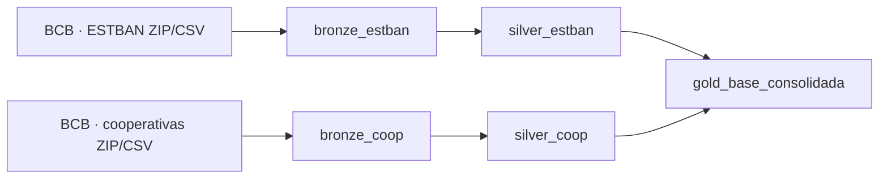

# ESTBAN Data Engineering

Pipeline exploratório em notebooks Databricks para combinar dados mensais ESTBAN e balancetes de cooperativas do Banco Central, padronizar indicadores e produzir uma base consolidada por instituição, município e competência.

**Estado:** implementação em três notebooks, sem testes ou outputs versionados. A execução real, as contagens e a validade dos mapeamentos contábeis não foram comprovadas nesta auditoria.

## Arquitetura



## Etapas

1. **Bronze:** baixa competências de dezembro de 2024 a março de 2026, concatena arquivos e sobrescreve tabelas Delta.
2. **Silver:** converte valores e mapeia verbetes/contas para indicadores.
3. **Gold:** filtra três cooperativas, agrega bancos em MT/RO/AM, marca municípios de abrangência e cria indicadores compostos.

## Executar

Importe os três notebooks em um ambiente Databricks com pandas, requests, PySpark e permissão para criar tabelas no schema corrente. Execute na ordem:

```text
01_bronze_estban.ipynb
02_silver_estban.ipynb
03_gold_estban.ipynb
```

## Grão da Gold

`origem × competência × instituição × UF × município × indicador × abrangência`.

## Limitações

- período, CNPJs, municípios e mapeamentos estão fixos no código;
- requisições não têm timeout/retry e competências ausentes são ignoradas silenciosamente;
- todas as tabelas são sobrescritas;
- valores inválidos viram zero por `coalesce`, o que pode esconder problemas;
- a divisão por 10 aplicada ao ESTBAN exige justificativa documental da unidade;
- não há contrato de schema, deduplicação, reconciliação ou teste de totais;
- municípios são comparados por texto, sem código IBGE;
- não há bundle, dependências, CI ou evidência de execução.

Antes de destacar, registre a definição oficial de cada conta, valide unidades e publique checks por competência e fonte.
